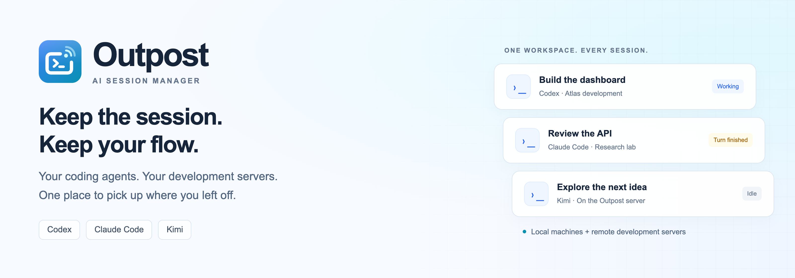
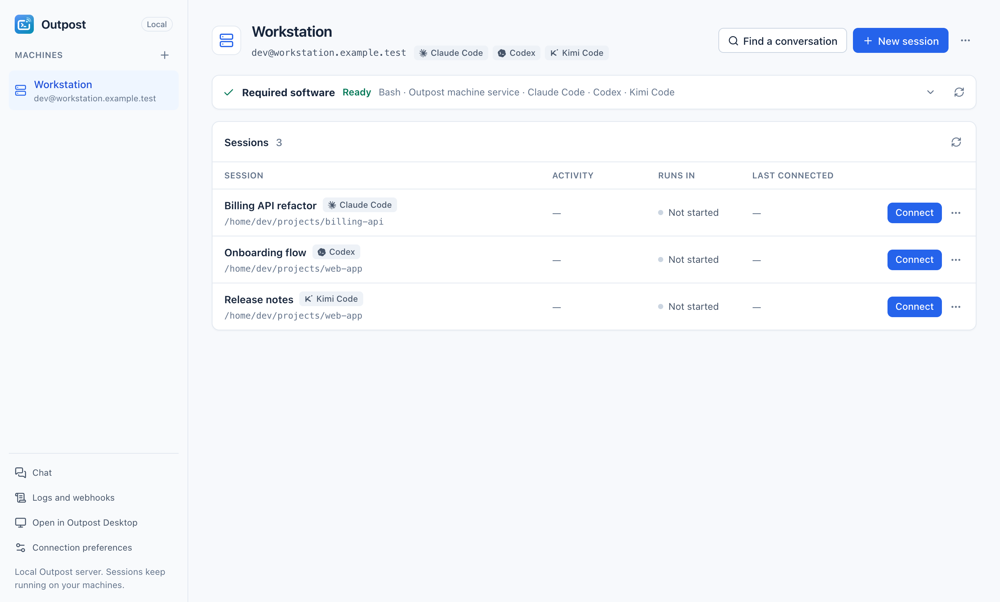
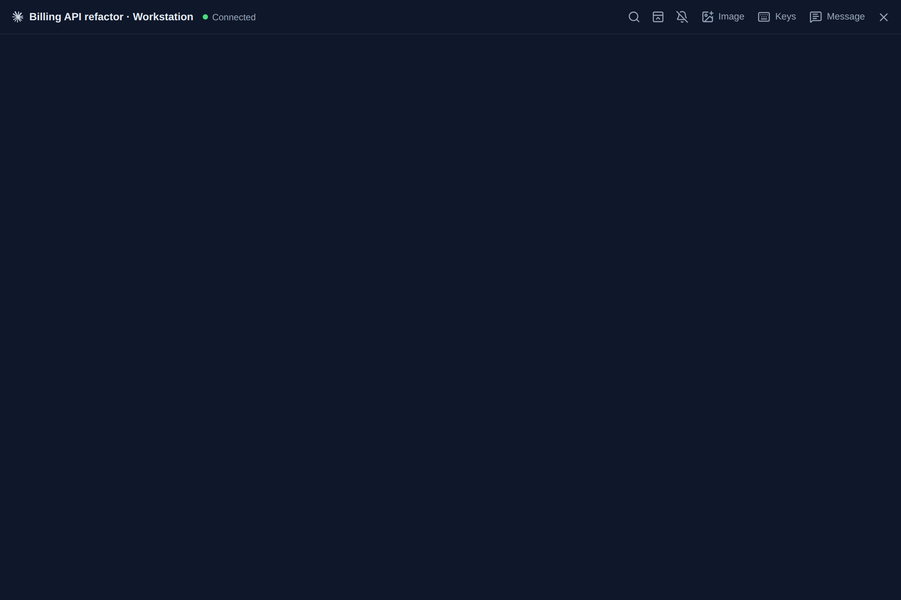

# Outpost



Outpost runs coding agents on your Linux machines. Open **Machines** to choose
a machine, start a session in a project directory, or reconnect to a running
agent. Claude Code, Codex, Kimi Code and Antigravity CLI offer persistent
terminals in the browser and Outpost Desktop. DeepSeek Harness uses Chat.

- **One Connect button.** Choose the web terminal or Outpost Desktop for macOS and Windows. Both attach to the same machine-owned session.
- **Feels native.** Paste screenshots with your normal paste shortcut and the agent receives the image. Shift+Enter inserts a newline. Text the agent copies lands on your clipboard. Links it opens open in your browser.
- **Managed sessions outlive connections.** Close the tab or lose Wi-Fi; the agent keeps working. Reconnect from any computer or your phone, to the same process.
- **Local terminals, too.** Outpost Desktop opens your local shell alongside managed sessions, with shared tabs, splits and clipboard controls. Local tabs work offline and end when closed.
- **Local tool or hosted service.** Run it on your own computer with your SSH config, or host it for a team with accounts and per-user SSH keys.
- **Know what needs you.** Each session shows whether the agent is working, idle, or finished a turn you haven't seen.
- **Find any conversation.** Search the coding tools' history on all your machines, including conversations started outside Outpost, and resume them as sessions.
- **See what happened.** Logs records when agents start, work, finish or fail, every message passed between sessions, channels and schedules, and errors, and sends what you choose to your own webhooks.
- **Recall work across machines.** The built-in Outpost MCP searches Claude Code, Codex, Kimi Code, DeepSeek Harness and Antigravity CLI histories across server-connected machines using keyword, semantic, or mixed search. Results identify the machine and tool; context and message tools page through the conversation.



## Requirements

| Where | What you need |
| --- | --- |
| Machines — where sessions run | Linux (including WSL), Bash and the Outpost machine service. Choose a connection setup below. |
| Outpost server | Node.js 24+ and OpenSSH, on Linux, WSL or macOS. |
| Web terminal | Any current browser, including on phones. |
| Outpost Desktop | macOS (Apple silicon or Intel) or Windows x64. Native GPUI terminal with local shells and managed Outpost sessions. |

For corporate machines that cannot open an outbound Outpost connection, choose
**Direct only** when adding the machine. The client connects to its HTTPS
endpoint. See the [V3 glossary](docs/ARCHITECTURE.md#v3-terminology), [installation, ownership and cleanup](docs/ARCHITECTURE.md#installing-and-removing-a-machine)
and [direct-only setup](docs/ARCHITECTURE.md#direct-only-machines).

## Run the local tool

```sh
ONNXRUNTIME_NODE_INSTALL=skip npm ci
npm run build
npm start          # http://127.0.0.1:3000
```

For development, `npm run dev` serves the UI at http://127.0.0.1:5173 with hot reload.

Local mode needs no account and accepts connections only from this computer.
SSH machines use your own OpenSSH configuration, agent and keys. Data lives in
`~/.outpost` (set `OUTPOST_DATA_DIR` to change it). On Windows, run Outpost
inside WSL and open http://localhost:3000 in your Windows browser: in WSL,
Outpost listens on all interfaces so Windows' localhost forwarding reaches it,
and still accepts only connections that arrive through localhost.

To use Outpost running on another machine, forward its port to the **same**
port locally (`ssh -L 3000:127.0.0.1:3000 that-machine`) and open
http://127.0.0.1:3000.

## Start a session on a machine

1. Open **Machines** at the server’s home address and choose **Add a machine**. Pick a connection method to see who connects to whom and what you need. Choose **Continue**, fill in the machine details, and choose **Add machine**. For **Direct only** or **Relay enabled**, follow the enrollment instructions on the machine page.
2. Select the machine and check **Required software**. Choose **New session**, then select a coding tool and its project directory.
3. Choose **Connect** to open the session in the web terminal or Outpost Desktop. Return to the same machine to reconnect. For a tool that runs in Chat, the session action is **Open in chat**.

## Edit a session and its conversations

**Edit session** in a session’s **…** menu changes its name, how messages reach
its terminal, its instructions and, under **Model, MCP servers and launch**, its
model, agent mode for Chat, MCP servers, arguments and environment. The name and message
delivery change at once. The rest applies when the session next starts: a running
session shows **Changes apply at the next start** with **Restart now**, which
restarts it in the same conversation. The coding tool and project directory stay
fixed; fork the session to work in another directory. **Edit source** shows the
same settings as one JSON document, for editing or pasting in bulk:

```json
{
  "name": "Docs writer",
  "delivery": "auto",
  "instructions": "You write and review the user documentation.",
  "model": "opus",
  "mode": "plan",
  "mcpServers": {
    "docs": { "type": "http", "url": "https://example.com/mcp", "headers": { "Authorization": "Bearer …" } },
    "db": { "command": "npx", "args": ["-y", "my-db-mcp"], "env": { "DB_URL": "…" } }
  },
  "args": "",
  "env": {}
}
```

- **Instructions** are added to the tool's own: in terminals and chat for Claude
  Code (`--append-system-prompt`) and Codex (`developer_instructions`), in chat
  for Antigravity CLI, and not yet for Kimi Code or DeepSeek Harness.
- **Model** and **mode** use the tool's own names for them, as its chat menus
  show them. Chat selects both whenever a conversation opens, and says so when
  the tool offers no such choice. Terminals start with the model.
- **MCP servers** use the usual `mcpServers` format, a command or
  `"type": "http"` with a URL, and run alongside Outpost's own server (`outpost`
  is reserved). Kimi Code and Antigravity CLI terminals get only Outpost's, from
  their shared plugins; chat adds a session's servers for every tool, and servers
  by URL where the tool's ACP server takes them.
- **Arguments** (Bash syntax) are added to the terminal command, and the
  **environment** applies to both.

**New session** can start from another session's settings: **Copy settings
from** fills in its instructions, model, mode, MCP servers, arguments and
environment, and picks its coding tool when the machine has it.

A session keeps the conversations its coding tool works in. Starting a new one
inside the tool (`/new`, `/clear`, or resuming another), or **New conversation**
in chat, adds it, and it becomes the one the session resumes. The session keeps
your name for it; the tool’s own title for the current conversation is shown
beneath. A conversation that a channel, another session or a schedule started is
titled by where it came from and what was asked, such as `#release · the user:
@api draft the notes`. **Conversations** lists them all and resumes an earlier one; resuming
while the session runs stops its coding tool first (chat starts it again in that
conversation). A conversation resumed in another session moves there, and the
session it left asks which conversation to continue.

## Find a conversation

**Find a conversation** on a machine's page in Machines, or typing in chat's
search box and choosing **Search conversation history** (or pressing Enter),
searches the coding tools' history on all your machines or one of them,
including conversations started outside Outpost. A conversation that already
belongs to a session opens it; any other can be linked as a new session that
resumes it.

## Logs and webhooks

**Logs and webhooks** in the sidebar opens your account's activity log in an
embedded [log-viewer](https://github.com/KevinWang15/log-viewer): agent status
changes, messages between you, channels, sessions and schedules, sessions created,
edited, started and stopped, machines added, unreachable or updated, terminal
connections, and errors. The sidebar's views filter it (Agent status, Messages,
Warnings and errors); the viewer itself filters by level, text and the fields
each event carries (`machine`, `session`, `state`, `channel`, `error`). Status changes are
recorded on the machine as they happen, so changes while Outpost was not
connected appear when it reconnects, at the time they happened. The log keeps
the newest 50,000 events.

A **webhook** sends matching events to a URL as they happen: one POST each, with
a JSON body Outpost defines and the headers you set (for example
`Authorization`). Choose which kinds of events it receives and the lowest level
(everything, warnings and errors, or errors only). Header values are stored on
the server and never shown again. Deliveries are retried on network errors,
429 and 5xx responses; redirects are not followed. A webhook that stops
delivering is logged once as a warning, and again when it delivers. A hosted server only sends to
public addresses. **Send a test** posts a sample event.

```json
{
  "version": 1,
  "webhook": { "id": "…", "name": "Team alerts" },
  "event": {
    "id": "…",
    "time": "2026-11-14T09:30:00.000Z",
    "level": "info",
    "kind": "agent",
    "type": "status",
    "message": "Billing API finished its turn",
    "machine": { "id": "…", "name": "Workstation" },
    "session": { "id": "…", "name": "Billing API" },
    "details": { "state": "finished", "previous": "working", "detail": null }
  }
}
```

`kind` is one of `agent`, `message`, `session`, `machine`, `channel`,
`schedule`, `terminal` and `webhook`; `level` is `info`, `warning` or `error`.
New fields may be added to `event` and `details`; existing ones keep their
meaning while `version` is 1.

## Fork a session

Choose **Fork** in a session’s **…** menu to create a new Git branch and
worktree on the same machine. A branch such as `feature/new-login` suggests
`/path/project-feature-new-login`; you can edit the path or restore the
suggestion. The branch starts at the source directory’s current commit,
leaving uncommitted changes in the source.

Only after Git succeeds does Outpost create a fresh conversation, using the
source session’s coding tool, arguments, and environment. The new session is
named after the branch and starts when you connect. Git must be installed on
the machine; invalid repositories, existing branches, and existing destination
paths produce an error without creating a session.

## Connect

Click **Connect** next to a session and choose a terminal. Check **Remember my
choice** first to open that terminal directly on future connections. This applies
to all sessions on this Outpost server in the current browser. Remembered
connections skip the dialog, including desktop opening and success messages;
the dialog returns if opening fails or takes longer than six seconds. To change it or
show the chooser again, open **Connection preferences** in the sidebar, choose a
terminal or **Ask every time**, and save. This preference does not change login
or desktop server trust requirements.

| Choice | Opens in | Installation | Authorization |
| --- | --- | --- | --- |
| Web terminal | A regular browser window; also works on phones | None | Your Outpost browser login requests a session ticket |
| Outpost Desktop | A native GPUI window with its own Outpost Dock/taskbar identity | Outpost Desktop | Transfers a session ticket from your signed-in browser; no second login |

Every choice attaches to the same persistent session. Closing a client disconnects
it; the coding session keeps running. You can change clients later.

Desktop Connect brings the app forward and selects the session's tab. If that
session is already open from the same browser login, its existing tab is reused,
including its draft and live connection. Keep Outpost Desktop and your server
updated together; an incompatible terminal interface shows an update message.

### Web terminal

Opens full-window in the browser. Paste images with your normal paste shortcut,
drop them onto the terminal, or use the image button. On phones, an on-screen
key bar (Esc, Tab, Ctrl, Alt, arrows, ⇧↩, ^C) and a message box are shown. Dropped connections reconnect by
themselves.

Both the web terminal and Outpost Desktop keep retrying through long outages,
with pauses between attempts. Returning online or waking a laptop checks the
connection immediately; Desktop also checks remote tabs in background windows.
Recovery restores the running session, its saved screen/history and current size,
and keeps unsent message drafts. It never automatically resends input or image
pastes. If delivery was interrupted, check the terminal before sending again.
If the tool exited while you were away, choose **Reconnect** to start it again.
Expired or revoked credentials require a fresh **Connect** from Outpost.

#### Phones and tablets

Open your hosted Outpost address in the phone's browser and choose **Connect →
Web terminal**. The terminal and its controls follow the visible area above the
keyboard. Use the message box for longer prompts; **Send** keeps the keyboard
open and clears an unchanged draft only after delivery is confirmed; edits made
while waiting are kept. **Keyboard** in the
key bar shows or hides the keyboard for direct terminal input. Swipe the key bar
sideways to reach the other keys.

Swipe vertically over terminal output to send the same scrolling gesture as a
mouse wheel. The application decides what that does; it does not pause remote output or add a history buffer. **Select text** in the key bar or context menu
opens a copy of the text currently on screen, where the phone's normal text
selection handles work. Use **Copy selection** or **Copy all**, then **Done** to
return. This does not pause the running session or retrieve older output.

Use the image button to choose a supported image from your phone. If clipboard
paste is blocked, touch and hold the message box and use the browser's Paste
command. Status and error messages remain visible on small screens.

When you return from another app or the network comes back, Outpost checks the
connection and reconnects if needed. It does not resend prompts automatically.
An expired login or a deliberately ended session still requires an
explicit connection. Your remote coding process continues while the phone is
away.

For iPhone/iPad notifications, use **Share → Add to Home Screen**, open Outpost
from that icon, connect with **Web terminal**, and tap the bell to allow
notifications. Android browsers with notification support can use the bell
directly. Home Screen web apps keep terminal navigation inside the app.
**Notifications require HTTPS and a running terminal page.** There is no
background push delivery while the browser is suspended or closed, and no offline
terminal. The notification button reports permission; browser/OS notification
settings still control whether an alert is displayed.

#### Keyboard, clipboard, and history

On macOS, **Ctrl+V** also pastes an image or text with the terminal focused,
in both the browser and Outpost Desktop. **Command+V** continues to work.
The browser may ask for clipboard permission for Ctrl+V; if access is blocked,
use Command+V instead.

In the web terminal, **Hide terminal toolbar** frees screen space. The button at
the top right restores it. The terminal context menu also offers copy, paste,
image upload, the message box and on-screen keys.

Attach images directly in the terminal: paste from the clipboard, drop a file
onto the terminal, or use the image button (also available in the context menu).
PNG, JPEG, GIF and WebP images up to 16 MB are supported. Outpost saves the image
on the session's machine and pastes its reference into the current prompt;
press Enter when you are ready to send. Uploads run separately from terminal
input and are cancelled if the connection drops. Local shell tabs save images
on your own computer.

Press **Cmd+F** on macOS or **Ctrl+F** on Windows/Linux to find text in the
current terminal. The search box floats at the top-right without resizing the
terminal. Matches are highlighted with a result count; **Enter** goes to the
next match, **Shift+Enter** to the previous one, and **Esc** closes search and
returns focus to the terminal. **Aa** toggles case sensitivity. Search is also
available from the terminal toolbar and right-click menu, and **Edit → Find in
terminal** in the desktop app. Web, remote desktop, and local shell tabs share
this feature. It searches the screen and scrollback held by the active client,
not files or output that has already left the buffer.
Highlights update with terminal output, including applications that redraw their
screen to scroll their own history. That history is searchable as the application
displays it; Outpost cannot search content the application has not sent to xterm.

Text selection is local to the terminal and copies when you release the mouse.
It does not pause the remote display. Applications that
request mouse events receive them normally; to select text locally in such an
application, hold **Shift** while dragging on Windows/Linux or **Option** on
macOS. You can also use **Copy** from the context menu or your usual copy shortcut.

The terminal retains up to **10,000 lines of scrollback in memory**, including
output produced while you are disconnected. Reconnecting restores that history,
the screen and terminal modes. The existing scrollbar browses actual local
terminal history; selecting text does not freeze the process. Screen clearing,
explicit scrollback clearing, and alternate-screen applications follow normal
terminal semantics. Full-screen applications can still provide their own
conversation/history viewer. Outpost does not force Codex into inline mode.

The machine must stay running: this preserves sessions across browser, app, SSH,
and Outpost server disconnects/restarts, not reboots or crashes of the
machine. Closing a tab disconnects; **Stop coding tool** in the session's **…**
menu explicitly stops it.

When the coding tool rings the terminal bell, the page and tab title show
which session rang, and a short chime plays. Click or type in the terminal
once to enable sound. Bells received while you are away stay marked until
you return; repeated bells are limited to one chime per second.

Click the bell button in the terminal toolbar to enable notifications,
then allow notifications in your browser. On Windows and macOS, bells also show
a system notification while the terminal is in the background. Clicking it
returns to the terminal; repeated bells produce one notification until you
return. This requires HTTPS (or localhost) and an open terminal tab. If alerts
do not appear, check the browser's site permissions and
[Windows notification settings](https://support.microsoft.com/en-us/windows/experience/notifications-and-do-not-disturb-in-windows)
or [macOS System Settings → Notifications](https://support.apple.com/guide/safari/sfri40734/mac),
including Focus / Do Not Disturb. Disable notifications through your browser's
site settings.

If a browser permission prompt is hidden, open the site controls beside the
address bar and allow Notifications. The terminal refreshes permission when
you return to it.



### Session files

Managed Codex, Claude Code, Kimi Code, DeepSeek Harness and Antigravity CLI sessions receive an **Outpost MCP** tool named `publish_file`.
Ask the agent to publish a generated image or document to your Outpost session;
the tool takes an absolute `path` and an optional download `name`. Any managed
coding tool can also publish from its shell:

```sh
outpost publish /absolute/path/to/report.pdf
```

When a session has files, its web or desktop terminal shows a **Files** badge
at the top right. Open it for thumbnails, filenames, dates and sizes, with
download and remove actions. Click any file to open the full-window viewer.
Use its left/right buttons or **← / →** keys to cycle through files, and **Esc**
to close. The viewer keeps filename, date, size, download and remove actions
visible; unsupported formats show **Preview not supported**. In the desktop app
the viewer covers the whole window, including split panes.
Windows and macOS downloads use the native Save dialog; web terminals use the
browser's download handling. The panel and viewer do not resize the terminal.
In the browser, thumbnails, previews and downloads share a bounded session cache, avoiding repeat
transfers while the file remains cached. Closing the file panel keeps the cache;
closing the session clears it.

Files are snapshots stored on the machine, survive client disconnects, and
appear again after reconnection. The same list holds files you attach in chat.
Removing a file leaves the original alone. Deleting the managed session also
deletes its files. Limits
are **32 MiB per file**, **100 files**, and **256 MiB total per session**.
PNG, JPEG, GIF and WebP have previews; other formats are available to download.
Local shell tabs do not have this session file list.

Outpost's MCP server is part of Outpost machine service, and every managed agent gets
it, in a terminal or in chat. Codex and Claude receive launch-specific MCP
configuration, and chat passes the same server over ACP. Kimi and Antigravity
use their native Outpost plugins, which also report activity. Their MCP servers
inherit the current process's session binding; ordinary Kimi or `agy` launches
outside Outpost expose no Outpost tools. No manual MCP setup is required, and
existing user MCP servers remain configured.

Update the server and desktop app together for native file downloads.

### Cross-machine history MCP

Managed Claude Code, Codex, Kimi Code, DeepSeek Harness and Antigravity CLI sessions receive five history tools in
the same **Outpost MCP** as `publish_file`, with no additional registration:

| Tool | Purpose |
| --- | --- |
| `search_history` | Search the account’s server-connected machines, or filter by machine, coding tool, session, working directory, role and dates. |
| `read_context` | Read a chronological page around a match, then page before or after it. |
| `read_message` | Retrieve further character pages of a long message. |
| `get_session` | Inspect the source machine, native conversation and transcript files, its lineage and its Outpost session. |
| `refresh_index` | Advance indexing and inspect machine availability and embedding coverage. |

For example, ask a session to **"Search my history across machines for the TLS
deployment failure, then read the surrounding discussion."** Keyword search
requires all terms; substring search preserves literal text. Semantic search
uses a pinned multilingual model on the Outpost server. Mixed search (the
default) combines keyword and semantic rankings. Single
technical identifiers and CJK terms use literal lookup automatically in mixed
mode; explicit semantic mode always uses embeddings.

Results include a stable machine ID, display name and host, coding tool,
native session ID, title, working directory and an opaque context cursor.
Histories include native conversations started outside Outpost and the CLI
storage directories pinned by managed sessions. Each hosted account has its own
index and can search only its configured machines. Removing a machine immediately
removes access to its cached results. An offline machine's already indexed history
remains searchable, with its availability reported in the response.

Indexing starts automatically, continues in the background and resumes after
server restarts. Large archives take time to ingest and embed; responses report
partial coverage and offline/unreadable sources. Terminal and chat MCP calls
travel on Outpost's connection to their machine, so closing the browser does not
disable history search. Source transcripts are read-only. Conversation text
and embeddings stay on the Outpost server; the first semantic index downloads
model weights and does not send conversation text to an external service.

The generated account index lives in `history/index.sqlite` below its workspace;
the shared model cache is `history-models` below `OUTPOST_DATA_DIR`. Include the
index in state backups. Search returns up to 20 results from bounded candidates;
context and message readers have explicit page and character budgets. Text
above 1 Mi characters in a message is retrieved from the source machine on
demand, rather than all being kept in the index. Native JSONL records above
8 MiB are skipped with a warning. Historical messages are data, not
instructions for the current agent.

History knows how conversations relate. When a coding tool forks or continues a
conversation, it copies earlier messages into the new one; search reports each
message once, in the conversation where it began, and lists the others that
contain it (`alsoIn`). `read_context` shows where a conversation branched and
where it came from, and `get_session` returns a conversation's lineage and the
Outpost session it belongs to. Messages before a compaction are marked, because
the agent now has only a summary of them; the summaries themselves are not
searched while the messages they replaced are. Results group by Outpost session
across all of its conversations.

DeepSeek history reads `$DSH_HOME/sessions` on each machine, including root and
subagent logs in formats v0–v4, raw JSONL and concatenated Zstandard frames.
Only the highest retained generation is scanned. Native files remain unchanged;
compressed input is decoded in memory by Outpost machine service on the machine, capped
at 256 MiB per file. An incomplete final frame
is retried after the native log changes. Use `tool: "deepseek"` to filter it.

### Outpost Desktop

Open **Download Outpost Desktop** in the Connect dialog, or visit `/desktop`
on your server. Download the matching macOS DMG (arm64 for Apple silicon,
x64 for Intel) or Windows x64 installer from
[GitHub releases](https://github.com/KevinWang15/outpost/releases).

1. On macOS, drag Outpost into Applications; on Windows, run the installer.
2. Open Outpost once to register its links.
3. In your browser, choose **Connect → Outpost Desktop** for a session.
4. Allow the browser to open the app and confirm the server on first use.

These are **unsigned previews**. After the first launch attempt, macOS may
require **System Settings → Privacy & Security → Open Anyway**. Windows may
show **SmartScreen → More info → Run anyway**. Only proceed with a release
you trust; release artifacts include checksums.

The desktop workspace opens your local shell on startup. The **+** button opens
another terminal. Right-click it to choose a shell or a managed Outpost
session. Use the Outpost logo to connect a server, sign in through your browser,
reopen recent sessions, or create a session on a machine. Choose **Machines ↗** next to a signed-in server to open its machine workspace in the system browser.

Use the split button to place a shell beside the focused terminal. Right-click
it to split top and bottom. Drag the divider to resize, or double-click a pane
header to zoom. Drag a tab or pane header onto another terminal to split at
the nearest edge. Drop it on the tab strip to reorder or create a tab. The tab
context menu also moves a tab or pane into its own window. Moving a pane keeps
its output, shell or managed connection, and message draft.

Right-click a tab or the terminal to open terminal actions. You can search
scrollback, compose a multiline message, clear the screen, copy a selection or
paste text and images. Managed panes also list session files, preview raster
images and save files through a native file dialog. Closing a local terminal
ends its shell. A managed session continues running on its machine.

| Action | macOS | Windows |
| --- | --- | --- |
| New local terminal | ⌘T | Ctrl+Shift+T |
| Next or previous tab | Ctrl+Tab or Ctrl+Shift+Tab | Ctrl+Tab or Ctrl+Shift+Tab |
| Split side by side | ⌘D | Ctrl+Shift+D |
| Split top and bottom | ⌘Shift+D | Ctrl+Alt+D |
| Focus another pane | ⌘Option+Right | Ctrl+Alt+Right |
| Zoom or restore focused pane | ⌘Shift+Enter | Ctrl+Shift+Enter |
| Find in scrollback | ⌘F | Ctrl+Shift+F |
| Copy selection or paste | ⌘C or ⌘V | Ctrl+Shift+C or Ctrl+Shift+V |
| Close focused terminal | ⌘W | Ctrl+Shift+W |

Build and run the native app from a checkout with the commands in
[CONTRIBUTING.md](CONTRIBUTING.md#desktop-development-and-previews).

## Chat with your sessions

Open **Chat** from the Machines sidebar to message sessions on server-connected machines or bring them into a channel. Replies stream in, the steps the agent took fold into
one line you can open (commands and their output, file edits as diffs), and
permission requests appear as buttons. Choose the agent's mode and model in the
header, attach files and images (paste, drop or the paperclip), and use its
slash commands.

- **Files go both ways.** What you attach is stored in the session's files on
  its machine and handed to the agent, which reads it with its own tools.
  Files the agent shares (`publish_file`) appear in its reply and in **Files**.
- **Channels** bring sessions from your server-connected machines together. A session
  replies when you mention it (`@api`, or `@all`); a reply that mentions another
  member passes the conversation on. Files attached in a channel are copied to
  each member that receives them.
- **Sessions message each other.** Agents get Outpost tools to list your
  machines and sessions, ask one of them for help, post to their channels and
  copy each other's files; the answer comes back as a message. A session running
  in a terminal gets messages typed in when its agent is idle and you are not
  typing, or holds them until you choose **Deliver now** (**Edit session**).
- **Schedules** send a session a message at set times, e.g. a weekday summary.
- **Instructions** give a session a role, added to the coding tool's own.
  A session can also start with a model, an agent mode for Chat and MCP servers of its
  own, next to Outpost's.

A session runs in a terminal or in chat, never both, and each view shows which
(**Runs in** in Machines). Opening a session that is not running starts nothing;
**Connect** starts it in a terminal, and **Start in chat** or sending it a message
starts it in chat. **Continue in chat** or **Continue in a terminal**, in the
session's **…** menu in either view, ends the coding tool where it runs and
continues the same conversation in the other. Chat uses each tool's [Agent Client Protocol](https://agentclientprotocol.com)
server. Install the Claude Code chat adapter from **Required software** to use Claude in Chat. Its terminal works without the adapter. See
[docs/CHAT.md](docs/CHAT.md) for how it works.

### DeepSeek Harness

Enable **DeepSeek Harness** on a server-connected machine and use **Required software** to install
the official `dsh` CLI (`@deepseek-ai/dsh@0.2.2-rc.1`). It requires Node.js 24.9+
and npm on that machine. Configure its normal DeepSeek credentials, or provide
`DEEPSEEK_API_KEY` in the session environment, then choose **New session** on that machine. Open the session in Chat. Outpost uses `dsh --profile acp`, preserves its native session ID and
`DSH_HOME` (default `~/.dsh`), and resumes the conversation after reconnecting.
Its Outpost MCP has the same tools as every session's, from file publishing to
history search and messaging other sessions. User profile and home configuration remain intact.

The official package has no bundled terminal interface, so Outpost opens these
sessions in Chat. The terminal picker excludes them. DeepSeek's ACP interface
does not apply custom session instructions or replay imported native messages;
Outpost retains messages from its own Chat journal, and earlier native messages
remain accessible through history MCP. See the [official ACP contract](https://github.com/deepseek-ai/deepseek-harness/blob/master/packages/acp/acp/README.md).

## Run a hosted service

Set `OUTPOST_MODE=hosted`. Each verified account gets its own workspace.
For an SSH machine, add the account’s Ed25519 public key to
`~/.ssh/authorized_keys` for the Linux user that runs the sessions.
Relay-enabled machines use pairing codes. Direct-only machines use offline enrollment.
Both terminal clients sign in through the hosted Outpost server.

```dotenv
OUTPOST_MODE=hosted
NODE_ENV=production
PUBLIC_APP_URL=https://outpost.example.com
OUTPOST_DATA_DIR=/var/lib/outpost
ENGAGE_LAB_USERNAME=…
ENGAGE_LAB_API_KEY=…
ENGAGE_LAB_FROM_EMAIL="Outpost <no-reply@example.com>"
OUTPOST_TRUST_PROXY=127.0.0.1,::1   # your reverse proxy
```

Production requires HTTPS and email delivery. Without mail settings on
loopback, development shows verification links in the UI. Put Outpost behind
an HTTPS reverse proxy that preserves the `Host` header and forwards WebSocket
upgrades for `/api/terminal`:

```nginx
proxy_http_version 1.1;
proxy_set_header Host $http_host;
proxy_set_header Upgrade $http_upgrade;
proxy_set_header Connection "upgrade";
proxy_read_timeout 75s;
```

**Container:** `docker build -t outpost .` builds a hosted image serving on
port 3000 as user 1000. Mount persistent storage at `/state` and back up the
whole data directory (accounts, workspaces, SSH keys, secret). Run one
instance per data directory.

## How it works

The **terminal client** (Outpost Desktop or the web terminal) attaches to a **session** on a **machine**. The **Outpost machine service** (`outpost-terminal`) runs the coding agent there. The machine enrolls with one Outpost server. Terminal input, output, published files and image paste use the
selected attachment.

| Machine configuration | How the session is reached |
| --- | --- |
| Direct only | The client obtains authorization from Outpost and connects to the machine’s HTTPS endpoint. The machine verifies the grant locally. |
| Relay enabled | The machine maintains an outbound link to Outpost. A reachable direct endpoint is preferred. Otherwise the server relays the attachment. |
| SSH | The client uses the Server-managed route. The Outpost server reaches the machine over SSH. |
| On the Outpost server | The client uses the Server-managed route. Sessions run on the Linux system running the Outpost server. |

**Required software → Outpost machine service → Install** downloads the matching Linux
executable into `~/.outpost/bin`, verifies its SHA-256 checksum and installs it
atomically. x86_64 and ARM64 machines with glibc or musl are supported. The runtime
is bundled; machines need neither Node.js nor Bun. Minimal musl installations also
receive the system `libstdc++` package. Running sessions keep their processes
when the executable is replaced.

The **Outpost machine service** GitHub Actions workflow is manual. Enable **Publish**
to create the versioned release the installer downloads. See
[machine/RELEASE_NOTES.md](machine/RELEASE_NOTES.md) for what it contains, and [docs/ARCHITECTURE.md](docs/ARCHITECTURE.md) for the
protocol and ownership model.

## Development

```sh
npm run build:terminal   # build Outpost machine service before machine, integration and browser tests
npm run check            # lint, typecheck, build, unit and machine tests
npm run test:integration # persistent PTYs: this computer and SSH in Docker
npx playwright install chromium webkit
npm run test:ui          # browser tests against a real backend
npm run test:mobile      # Android Chromium, iPhone WebKit, iPad WebKit
npm run docs:capture     # refresh README screenshots
```

Contributions are welcome; see [CONTRIBUTING.md](CONTRIBUTING.md) and
[SECURITY.md](SECURITY.md).

## License

[MIT](LICENSE). See [third-party notices](THIRD_PARTY_NOTICES.md).
