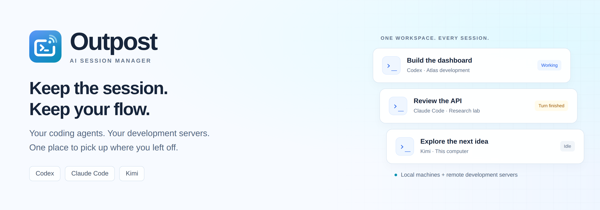
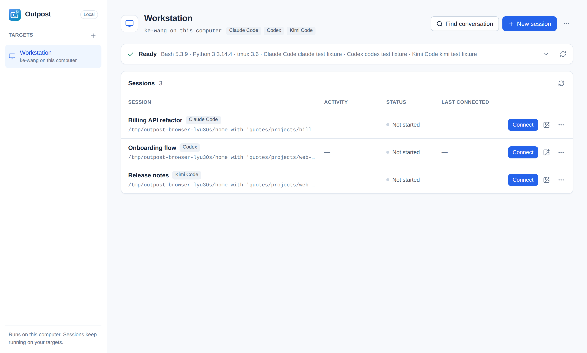
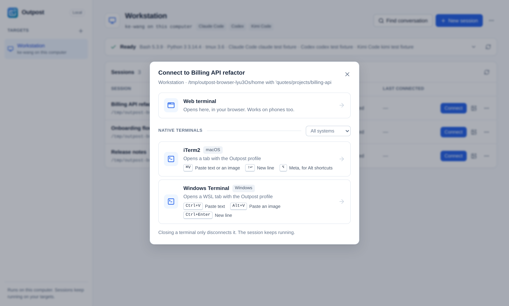
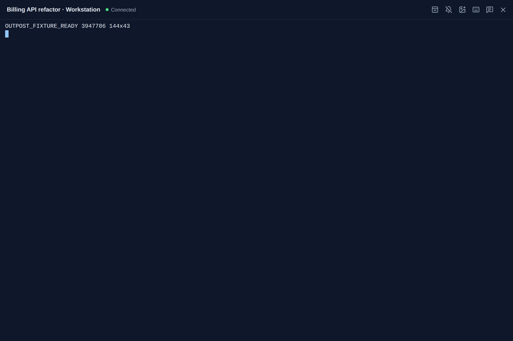

# Outpost



Outpost keeps your **Claude Code, Codex and Kimi Code** sessions running in tmux
on your Linux machines, and lets you come back to them from your browser or
your own terminal app — with paste, copy, Shift+Enter and links working as if
the agent ran on your computer.

- **One Connect button.** Choose the web terminal, Terminal app, iTerm2 on macOS, or Windows Terminal with WSL. All use the same connection path in both deployment modes.
- **Feels native.** Paste screenshots with ⌘V (iTerm2) or Alt+V (Windows Terminal) and the agent receives the image. Shift+Enter inserts a newline. Text the agent copies lands on your clipboard. Links it opens open in your browser.
- **Sessions outlive connections.** Close the tab or lose Wi-Fi; the agent keeps working. Reconnect from any computer or your phone, to the same process.
- **Local tool or hosted service.** Run it on your own computer with your SSH config, or host it for a team with accounts and per-user SSH keys.
- **Know what needs you.** Each session shows whether the agent is working, idle, or finished a turn you haven't seen.
- **Find any conversation.** Search the history on a target, including conversations started outside Outpost, and resume them as sessions.



## Requirements

| Where | What you need |
| --- | --- |
| Targets — where sessions run | Linux with Bash, Python 3.9+ and tmux 3.2+, reachable over SSH as root. The computer running Outpost can be a target too when it runs Linux (including WSL). Outpost can install missing software for you. |
| Outpost server | Node.js 24+ and OpenSSH, on Linux, WSL or macOS. |
| Native terminals | **macOS:** iTerm2 and Python 3.9+ (`xcode-select --install`). **Windows:** Windows Terminal and a WSL distribution with Python 3. |
| Web terminal | Any current browser, including on phones. |
| Terminal app | **macOS:** Chrome or Edge and Python 3.9+. **Windows:** Chrome or Edge and WSL with Bash and Python 3. Connector 2.1.1 recommended. |

## Run the local tool

```sh
npm ci
npm run build
npm start          # http://127.0.0.1:3000
```

For development, `npm run dev` serves the UI at http://127.0.0.1:5173 with hot reload.

Local mode needs no account and accepts connections only from this computer.
SSH targets use your own OpenSSH configuration, agent and keys. Data lives in
`~/.outpost` (set `OUTPOST_DATA_DIR` to change it). On Windows, run Outpost
inside WSL and open http://localhost:3000 in your Windows browser: in WSL,
Outpost listens on all interfaces so Windows' localhost forwarding reaches it,
and still accepts only connections that arrive through localhost.

To use Outpost running on another machine, forward its port to the **same**
port locally (`ssh -L 3000:127.0.0.1:3000 that-machine`) and open
http://127.0.0.1:3000.

## Fork a session

Choose **Fork** in a session’s **…** menu to create a new Git branch and
worktree on the same target. A branch such as `feature/new-login` suggests
`/path/project-feature-new-login`; you can edit the path or restore the
suggestion. The branch starts at the source directory’s current commit,
leaving uncommitted changes in the source.

Only after Git succeeds does Outpost create a fresh conversation, using the
source session’s coding tool, arguments, and environment. The new session is
named after the branch and starts when you connect. Git must be installed on
the target; invalid repositories, existing branches, and existing destination
paths produce an error without creating a session.

## Connect

Click **Connect** next to a session and choose a terminal. The dialog
preselects your computer's operating system; the web terminal is always at the
top.

| Choice | Opens in | Connector | Authorization |
| --- | --- | --- | --- |
| Web terminal | A regular browser window; also works on phones | No | Uses the browser's Outpost login to request a terminal ticket |
| Terminal app | A Chrome/Edge window without browser tabs or an address bar | Yes | Transfers a ticket from your signed-in Outpost browser; no second login |
| iTerm2 | A native macOS terminal tab | Yes | Same scoped terminal ticket |
| Windows Terminal | A native Windows terminal tab running WSL | Yes | Same scoped terminal ticket |

Every choice attaches to the same tmux session. Closing a client disconnects
it; the coding session keeps running. You can change clients later.



### Web terminal

Opens full-window in the browser. Paste images with your normal paste shortcut
or the image button. On phones, an on-screen key bar (Esc, Tab, Ctrl, Alt,
arrows, ⇧↩, ^C) and a message box are shown. Dropped connections reconnect by
themselves.

Use **Hide terminal toolbar** for more screen space; the small button at the
top right restores it. This preference also applies to Terminal app. Connection
errors, link prompts and bell notices remain visible while the toolbar is hidden.

The scrollbar on the right navigates the session's saved terminal output,
including output from before you opened this window (up to 50,000 lines).
Drag its thumb or click the track to jump through history. Use the arrow at
the bottom to **Return to live output**. **Shift+Page Up / Page Down** moves
a screen at a time; when the scrollbar has keyboard focus, **Home / End**
jumps to the oldest output or back to live output. These controls work in
both the web terminal and Terminal app, including with the toolbar hidden.

Outpost starts Codex in inline mode so its output enters terminal history.
An already-running full-screen Codex session keeps its original mode: its
sidebar has **Oldest**, **Previous page**, **Next page**, and **Latest** buttons
instead of a draggable thumb. **Shift+Page Up / Page Down** also works there.
To enable the draggable scrollbar, exit Codex cleanly and reconnect the same
session. Reloading the page alone does not restart Codex. Other full-screen
applications use their own scrolling controls.

When the coding tool rings the terminal bell, the page and tab title show
which session rang, and a short chime plays. Click or type in the terminal
once to enable sound. Bells received while you are away stay marked until
you return; repeated bells are limited to one chime per second.

Click the bell button in the terminal toolbar to enable desktop notifications,
then allow notifications in your browser. On Windows and macOS, bells also show
a system notification while the terminal is in the background. Clicking it
returns to the terminal; repeated bells produce one notification until you
return. This requires HTTPS (or localhost) and an open terminal tab. If alerts
do not appear, check the browser's site permissions and
[Windows notification settings](https://support.microsoft.com/en-us/windows/experience/notifications-and-do-not-disturb-in-windows)
or [macOS System Settings → Notifications](https://support.apple.com/guide/safari/sfri40734/mac),
including Focus / Do Not Disturb. Disable notifications through your browser's
site settings.

In Terminal app, the bell button opens **notification setup** directly in a
browser tab. Click **Enable notifications** there, or use the site controls
beside the address bar to allow notifications. In a regular web terminal,
**Open notification setup** is also available if the permission prompt is
hidden. Return to the terminal after allowing notifications; it reads the new
permission without reconnecting. Use the same browser and profile as the
terminal: Chrome and Edge do not share notification permissions. No sign-in
is needed on this setup page.



### Terminal app (PWA web terminal)

Choose **Connect → Terminal app** for the same web terminal in a dedicated
desktop window. It shares keyboard handling, image paste, reconnects, sound
and desktop notifications with the regular web terminal. Install or update
the connector as described below; older connectors cannot open this choice.

Connector 2.1.1 uses Chrome first on both macOS and Windows, with Edge as a
fallback. Update the connector and close/reopen the app to apply this choice;
updating the server does not change an installed connector. macOS browsers
can be in `/Applications` or `~/Applications`;
Windows browsers are located through their registered App Paths. Windows
uses WSL to run the connector, but **Windows Terminal is optional** for this
choice. Safari and Firefox can be used to browse Outpost and launch a session;
the connector opens the terminal in Chrome or Edge.

Outpost supplies a standalone PWA manifest at `/terminal/app`. You may install
that page through your browser's app menu for a dock/taskbar shortcut. The
connector opens a fresh browser app window for each connection and does not
require a separately installed PWA or automate PWA installation. An installed
shortcut starts at the connection instructions; select the session through
Outpost's Connect dialog. A network connection is required; no terminal data
or account pages are cached for offline use.

Your signed-in browser requests a single-use ticket valid for five minutes.
The app consumes it, removes it from its address, and connects directly to
Outpost. It does not need to share login cookies with the original browser.
Reloading the same window uses a resume ticket in that window's session storage.
If browser storage is disabled, use Connect again after a reload. Expired or
already-used links also require a fresh Connect. Signing out of the original
Outpost login revokes its terminal connections, including app windows.

### Connector setup (all desktop choices)

The first time, Outpost asks you to set up your computer with one command (run
it in Terminal/iTerm2 on a Mac, or in your WSL shell on Windows):

```sh
curl -fsSL https://your-outpost/connector/install.sh | bash
```

This installs the **Outpost Connector** in `~/.outpost-connector`, trusts that
Outpost server, and registers `outpost://` links. After that, Connect opens a
window or tab in your chosen terminal, and the dialog confirms when it's attached.
The connector stores no Outpost account password or login cookie. Its trusted
server list is shared by all desktop choices.

### Native terminal shortcuts

| | iTerm2 (macOS) | Windows Terminal (WSL) |
| --- | --- | --- |
| Paste text | ⌘V | Ctrl+V |
| Paste an image | ⌘V or Ctrl+V | Alt+V, or Ctrl+V when the clipboard holds an image |
| New line in the prompt | ⇧↩ | Ctrl+Enter |
| Copy | Select with the mouse (copies on release) | Select with the mouse (copies on release) |
| Terminal's own selection | Hold ⌥ while selecting | Hold Shift while selecting |
| Detach | Ctrl+\\ or close the tab | Ctrl+\\ or close the tab |

The connector adds an **Outpost** profile to iTerm2 (inheriting your default
profile, with ⌘V, ⇧↩ and Option-as-Meta mapped) and a hidden **Outpost**
profile to Windows Terminal. Ctrl+V and Alt+V only paste an image when the
clipboard holds one; otherwise they reach the program unchanged. Windows
Terminal does not let profiles bind keys, and it sends Shift+Enter to WSL as a
plain Enter, so use Ctrl+Enter for a newline there.

After a detach, the tab shows a banner: **Enter** reconnects, **Ctrl+C**
closes it. Network drops and Outpost restarts reconnect automatically.

### Update or remove the connector

Run the installer again to update the connector. To remove the connector,
terminal integration, and trust for **all** Outpost servers, run this as the
same user (and in the same WSL distribution on Windows) used for installation:

```sh
curl -fsSL https://your-outpost/connector/install.sh | bash -s -- --uninstall
```

The installed `~/.outpost-connector/bin/outpost-connector uninstall` command
also removes it without downloading the installer. Uninstalling leaves Outpost
server data and coding sessions intact.

## Run a hosted service

Set `OUTPOST_MODE=hosted`. Users sign up with a verified email, get their own
workspace and an Ed25519 SSH key that they authorize on their servers
(`/root/.ssh/authorized_keys`). The web terminal and native terminals work
exactly as in local mode; native terminals connect to the hosted server.

```dotenv
OUTPOST_MODE=hosted
NODE_ENV=production
PUBLIC_APP_URL=https://outpost.example.com
OUTPOST_DATA_DIR=/var/lib/outpost
ENGAGE_LAB_USERNAME=…
ENGAGE_LAB_API_KEY=…
ENGAGE_LAB_FROM_EMAIL="Outpost <no-reply@example.com>"
OUTPOST_TRUST_PROXY=127.0.0.1,::1   # your reverse proxy
```

Production requires HTTPS and email delivery. Without mail settings on
loopback, development shows verification links in the UI. Put Outpost behind
an HTTPS reverse proxy that preserves the `Host` header and forwards WebSocket
upgrades for `/api/terminal`:

```nginx
proxy_http_version 1.1;
proxy_set_header Host $http_host;
proxy_set_header Upgrade $http_upgrade;
proxy_set_header Connection "upgrade";
proxy_read_timeout 75s;
```

**Container:** `docker build -t outpost .` builds a hosted image serving on
port 3000 as user 1000. Mount persistent storage at `/state` and back up the
whole data directory (accounts, workspaces, SSH keys, secret). Run one
instance per data directory.

## Upgrading from v1

v2 reads v1 data without changing it:

- Targets from `targets.json` are imported into `workspace.json`. Windows (WSL
  distribution) targets are not imported; add WSL as an SSH target or run
  Outpost inside WSL.
- On each target, tmux sessions from `~/.outpost/sessions.json` are imported
  into `~/.outpost/registry.json`, and running ones stay attached to the same
  tmux server. dtach sessions are left in the v1 file.
- Removed in v2: dtach, macOS targets, desktop terminal launching, copied
  connection commands, uploaded web-terminal keys and the separate signal
  channel. Running v1 sessions should be restarted once so links from the
  agent reach your terminal.

## How it works

```text
web terminal / native connector ⇄ WebSocket ⇄ Outpost ⇄ SSH or local shell ⇄ relay ⇄ tmux ⇄ coding tool
```

Every connection takes this one path; tmux is the only place terminal state
lives, so connections are disposable. The target runtime is a Python program
sent with each operation — nothing is installed on targets besides tmux and
`~/.outpost` state. See [docs/ARCHITECTURE.md](docs/ARCHITECTURE.md) for the
principles, protocols, security model and how to add a terminal or a coding
tool.

## Development

```sh
npm run check            # lint, typecheck, build, unit and Python tests
npm run test:integration # real tmux: local targets, the connector in a PTY, SSH in Docker
npx playwright install chromium
npm run test:ui          # browser tests against a real backend
npm run docs:capture     # refresh README screenshots
```

Contributions are welcome; see [CONTRIBUTING.md](CONTRIBUTING.md) and
[SECURITY.md](SECURITY.md).

## License

[MIT](LICENSE). See [third-party notices](THIRD_PARTY_NOTICES.md).
