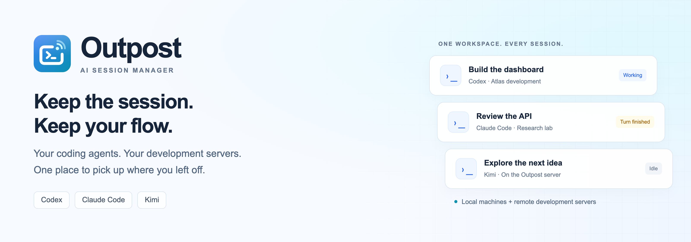

# Welcome to Outpost

Outpost runs coding agents on your own Linux machines and keeps every session alive even when you close your laptop, switch devices, or lose Wi-Fi.

## How Outpost fits together

| Concept | What it is |
| --- | --- |
| **Machine** | A Linux host (workstation, VM, server, or WSL) where your repositories and coding tools live. |
| **Session** | A persistent coding-agent workspace bound to one project directory and one tool (Claude Code, Codex, Kimi Code, Antigravity CLI, or DeepSeek Harness). |
| **Terminal** | A live interactive terminal attached to a session — in **Outpost Desktop** (native macOS/Windows app) or in your browser. |
| **Chat** | A structured conversation UI over the same sessions, plus multi-agent **Channels** and **Schedules**. |
| **Machine CLI** | The `outpost` command installed directly on your Linux machines to create, list, and auto-open sessions from any shell. |

> [!TIP]
> You can switch seamlessly between **Outpost Desktop**, the **Web terminal**, and **Chat** on the same session. Sessions are owned by the Linux machine, not the browser tab.

## Quick start

1. **Add a machine** in [Machines](/) — connect over SSH (using your OpenSSH config) or enroll an outbound machine behind NAT. See [Machines & Setup](02-machines.md).
2. **Start a session** from the web UI, Outpost Desktop, or directly from a shell on the machine with `outpost new`. See [Sessions & Conversations](03-sessions.md) and [Machine CLI](05-machine-cli.md).
3. **Connect** using **Outpost Desktop** for tabs, split panes, local shells, and native search, or open the **Web terminal** from any browser or phone. See [Desktop & Web Terminals](04-terminals.md).

## Local mode vs. Hosted mode

- **Local mode** runs on your own machine (or WSL) with no account login, uses your existing OpenSSH config and keys, and accepts connections only on localhost.
- **Hosted mode** supports user accounts, per-user SSH keys, outbound enrolled machines behind firewalls, and mobile/remote access over HTTPS.

## Where to go next

- [Machines & Setup](02-machines.md) — connect Linux hosts and manage coding tool installations.
- [Sessions & Conversations](03-sessions.md) — edit session harnesses and directories, configure launch settings, track live status, fork Git worktrees, and manage conversations.
- [Desktop & Web Terminals](04-terminals.md) — unified split-pane chooser, search, scrollbar, clipboard, image paste, experimental interactive SSH bridge, and mobile web terminal.
- [Machine CLI](05-machine-cli.md) — launch sessions from any terminal with an interactive TUI or scriptable flags and automatic tab opening.
- [Chat, Schedules & Logs](06-chat-and-logs.md) — multi-agent channels, scheduled runs, cross-machine history search, and webhooks.
