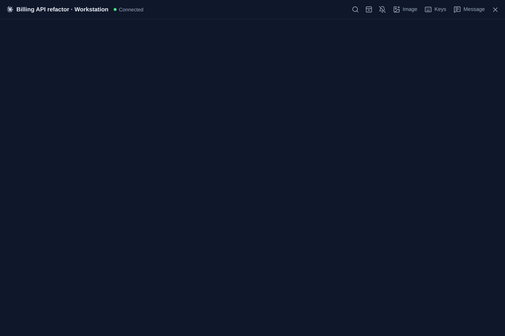
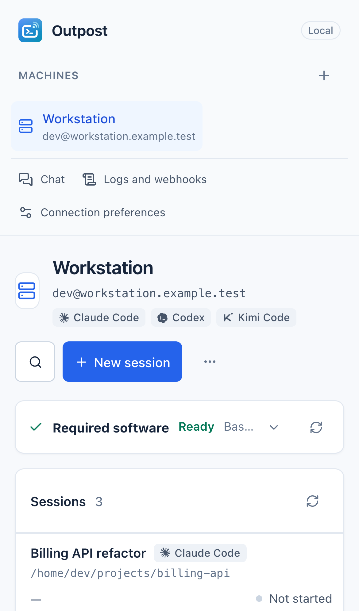

# Desktop & Web Terminals

Every terminal-capable session can be opened in **Outpost Desktop** (native GPUI app for Windows and macOS) or directly in any modern browser via the **Web terminal**. Both attach to the exact same running process on your Linux machine.

## Outpost Desktop

Outpost Desktop combines your **local shell** (PowerShell, CMD, WSL on Windows; zsh/bash on macOS) and your **remote Outpost sessions** in one fast native workspace.

### Tabs and split panes

- **New tabs (`+`)**: Click **+** in the title bar to pick any configured local shell profile or choose **Outpost session…** to connect or create a remote session. Drag tabs to reorder them or pull a tab out into its own window.
- **Split pane chooser**: Triggering a split from anywhere — the toolbar **Split** button (left-click to split side by side, right-click to split top and bottom), keyboard shortcuts (`Ctrl+Shift+D` / `Cmd+D` side by side, `Ctrl+Alt+D` / `Cmd+Shift+D` top and bottom), the pane **···** menu, a tab right-click menu, or the terminal context menu — opens the same chooser menu as **+**, so you can open any local shell profile or an **Outpost session…** directly into the new split.
- **Drag panes**: Drag any pane header or tab to split another pane — a cursor-following preview pill and contextual drop overlay show exactly where the pane will land (left, right, top, bottom, or as a new tab).
- **Quick switcher**: Press `Ctrl+Shift+P` (`Cmd+P` on macOS) to search and switch between open panes and remote sessions, ordered by most recently used.

### Terminal search

Press `Ctrl+Shift+F` (`Cmd+F` on macOS) in Outpost Desktop — or `Ctrl+F` (`Cmd+F`) in the Web terminal — to open the iTerm2-style find bar:

- Incremental highlighting across both the visible viewport and full scrollback history.
- Toggle **Case sensitive** (`Aa`), **Whole word** (`W`), and **Regex** (`.*`).
- Step through matches with `Enter` / `Shift+Enter` or the previous/next buttons; press `Esc` to close and return focus to the terminal.

### Scrollbar and scrollback

- An iTerm2-style overlay capsule scrollbar appears when scrolling or hovering near the right edge of a pane and auto-hides when idle.
- Drag the thumb for smooth scrubbing through deep scrollback histories (configurable in **Settings**, including **Unlimited scrollback**).
- Keyboard scrollback shortcuts let you jump by page, line, or straight to the top/bottom of history.

### Status indicators, bells, and reconnect

- **Live status badges (OSC 7501)**: Both managed Outpost sessions and local shell panes display live working, waiting, and turn-finished badges in tabs and pane headers whenever a running program emits OSC 7501 status updates.
- **Quieter active bells**: Terminal bell indicators on the currently active pane automatically clear after 2 seconds (or immediately when you start typing), while bells in background panes stay visible until you switch back to them.
- **Clean reconnect**: When a remote connection drops or you reload a pane (`Ctrl+Shift+R` / `Cmd+R`), Outpost Desktop shows a compact floating status card and cleanly reattaches with a fresh launch token.

### Native ergonomics

- **Image paste**: Copy a screenshot and paste normally (`Ctrl+V` / `Cmd+V`) — Outpost uploads the image to the remote machine and passes it to the coding agent (or choose **Paste image as file path** from the right-click menu).
- **Newlines**: Press `Shift+Enter` to insert a literal newline in coding tools without submitting the prompt.
- **Clipboard (OSC 52)**: Copy inside remote tools (including `tmux` or editors) and it lands on your local clipboard.
- **Auto-open from CLI**: Running `outpost new` or `outpost attach` inside any Outpost Desktop pane (including a local WSL/SSH shell pane!) automatically opens and focuses the target session in a new tab. See [Machine CLI](05-machine-cli.md#auto-open-in-outpost).

### Interactive SSH bridge (Experimental)

When you run interactive `ssh` from an **Outpost Desktop local shell** (PowerShell, Command Prompt, WSL, zsh, or bash) to a Linux machine that has the Outpost machine service installed, Outpost transparently upgrades that SSH session (connections to hosts without Outpost pass through unchanged).

Running `claude`, `codex`, `kimi`, or `agy` inside that SSH session automatically gains Outpost Desktop conveniences without creating a managed session first:

- **Image paste over SSH**: Paste screenshots with `Ctrl+V` / `Cmd+V` (or **Paste image as file path** from the right-click menu) directly into the remote agent.
- **Live status badges**: Tab and pane headers display live working, waiting, and turn-finished indicators via OSC 7501.
- **Outpost MCP**: On enrolled machines, the wrapped agent receives Outpost's built-in history search and machine/session read tools automatically.

> [!NOTE]
> The interactive SSH bridge is experimental. Set `OUTPOST_DISABLE_SSH_BRIDGE=1` in your shell environment to opt out at any time.

### Keyboard shortcuts

| Action | macOS | Windows / Linux |
| --- | --- | --- |
| New local terminal tab | `Cmd+T` | `Ctrl+Shift+T` |
| Outpost sessions picker | `Cmd+Shift+O` | `Ctrl+Shift+O` |
| Switch session | `Cmd+P` | `Ctrl+Shift+P` |
| Split side by side (opens chooser) | `Cmd+D` | `Ctrl+Shift+D` |
| Split top and bottom (opens chooser) | `Cmd+Shift+D` | `Ctrl+Alt+D` |
| Focus another pane | `Cmd+Option+Arrow` | `Ctrl+Alt+Arrow` |
| Zoom or restore focused pane | `Cmd+Shift+Enter` | `Ctrl+Alt+Enter` |
| Find in terminal | `Cmd+F` | `Ctrl+Shift+F` |
| Reload / reconnect terminal | `Cmd+R` | `Ctrl+Shift+R` |
| Close focused pane / tab | `Cmd+W` / `Cmd+Option+W` | `Ctrl+Shift+W` / `Ctrl+Alt+W` |

## Web terminal

The Web terminal runs in desktop and mobile browsers (including as a standalone PWA):

- Supports session file browsing, image paste and upload, in-terminal search (`Ctrl+F` / `Cmd+F`), bell notifications, automatic reconnect, and **OSC 7770 auto-open** when you run `outpost new` or `outpost attach` inside a web terminal.

### Phones and tablets

Open your Outpost server from a phone or tablet browser (or add it to your Home Screen as a PWA) to check session status and jump into any terminal on the go:

- Includes a swipeable mobile **KeyBar** (`Esc`, `Tab`, `Ctrl`, `Alt`, arrows, `⇧↩`, `^C`), a multiline message composer that stays above the on-screen keyboard, and a **Select text** mode for native copy handles.
